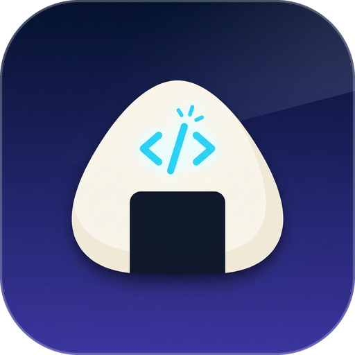

<div align="center">
  
  <h1>Onigiri Editor ユーザーマニュアル 🍙</h1>
  <p><strong>AI時代のクロスプラットフォーム対応 Markdown・コード・Web開発プレビュー統合エディタ（v1.0.4）</strong></p>
  <p>
    <a href="README.md">English</a> | <strong>日本語</strong> ・
    <a href="../README.ja.md">リポジトリトップ (README)</a>
  </p>
</div>

---

## 目次

1. [はじめに・言語設定](#1-はじめに言語設定)
2. [3つの UI モードと画面構成](#2-3つの-ui-モードと画面構成)
3. [Markdown・双方向ビジュアル編集](#3-markdown双方向ビジュアル編集)
4. [高機能テキスト編集＆右クリックメニュー](#4-高機能テキスト編集右クリックメニュー)
5. [文字コード・改行コード（EOL）](#5-文字コード改行コードeol)
6. [多言語シンタックスハイライト＆プレビュー](#6-多言語シンタックスハイライトプレビュー)
7. [ワークスペース・セッション復元・外部変更検知](#7-ワークスペースセッション復元外部変更検知)
8. [開発サーバー連携＆2パターンのブラウザ表示](#8-開発サーバー連携2パターンのブラウザ表示)
9. [AIチャット・接続サポート・整形ツール](#9-aiチャット接続サポート整形ツール)
10. [書き出し・テーマ・設定一覧](#10-書き出しテーマ設定一覧)
11. [キーボードショートカット・メニュー一覧](#11-キーボードショートカットメニュー一覧)

---

## 1. はじめに・言語設定

**Onigiri Editor** は、macOS（Apple Silicon / Intel）・Windows（x64）・Linux（x64）で動作する軽量・高速な統合エディタです。

### 初回起動と言語自動判定

- 初回起動時は OS の表示言語を自動判定します。日本語環境の OS では **日本語 UI・日本語メニューバー** で起動し、それ以外の言語環境では **英語 UI・英語メニューバー** で起動します。
- 表示言語は、アプリ右上の **言語切替ボタン**（`日本語` / `EN`）、**設定（`⌘,` / `Ctrl+,`）→ 全般・表示**、または **コマンドパレット（`⌘K` / `Ctrl+K`）** からいつでも切り替えられます。
- **ヘルプ → オンラインマニュアル**（またはコマンドパレットの「オンラインマニュアル」）を開くと、**日本語 UI のときは本ページ（`doc/README.ja.md`）、英語 UI のときは英語版マニュアル（`doc/README.md`）** が外部ブラウザで開きます。

---

## 2. 3つの UI モードと画面構成

用途に合わせて上部ヘッダーバー、メニューの **表示**、またはショートカット **`⌘\` / `Ctrl+\`** で 3 つのモードを切り替えられます。

| モード | おすすめの用途 | 主な画面構成 |
| :--- | :--- | :--- |
| **シンプル (Simple)** | メモ、コードの素早い確認・編集 | タブ・サイドバーを隠した単一ペインのエディタ中心構成 |
| **標準 (Basic)** | 普段の執筆・ビジュアル編集・AI相談 | エディタ＋双方向プレビュー＋書式バー＋AIチャット |
| **拡張 (Advanced)** | 開発プロジェクト管理・マルチファイル作業 | マルチタブ、左サイドバー（ファイル/アウトライン/スニペット）、開発サーバー連携、スナップショット、文字数目標・推定トークン表示 |

### レイアウトとバーの表示制御

- **表示レイアウト切替**: 上部バーで **エディタ** / **分割** / **プレビュー** を切り替えられます。
- **集中モード (Zen Mode)**: `⌘⇧F` / `Ctrl+Shift+F` で周辺パネルを隠し、執筆に集中できます（`Esc` で終了）。
- **上部ヘッダーバー／書式ツールバー／ステータスバーの表示切替**:
  - メニューバーの **表示 → 上部ヘッダーバーを表示**・**表示 → 書式ツールバーを表示**、または設定・コマンドパレットから切り替えられます。
  - **設定 → 全般・表示** には **シンプルモード時に上部ヘッダーバーを非表示にする**・**シンプルモード時に書式ツールバーを表示する** もあります。
  - 上部ヘッダーバーを隠している間も、**ステータスバー右端のクイックボタン**（`シンプル → 標準`・`設定`）、メニューバーの **表示**、`⌘,` / `Ctrl+,`、`⌘\` / `Ctrl+\` からいつでも戻せます。

---

## 3. Markdown・双方向ビジュアル編集

### 双方向同期編集（CodeMirror 6 ↔ TipTap）

- **分割** または **プレビュー** 表示時、左ペインのソースエディタ（CodeMirror 6）と右ペインのリッチビジュアルエディタ（TipTap）のどちらで編集してもリアルタイムに同期します。
- **編集中行／ブロックの同期マーカー**: 設定の **編集中ペインの対応行・ブロックを相手側にマーク表示** が ON のとき、編集中ペインのカーソル行に対応する相手側のブロックや行がハイライト表示されます。
- **スクロール同期 / タイプライタースクロール**: エディタとプレビューのスクロール位置連動、および入力行を常に画面中央付近に保つタイプライターモードを設定から切り替えられます。

### 書式ツールバー・挿入機能

- **見出し・文字装飾**: 見出し `H1` / `H2` / `H3`、太字（`⌘B` / `Ctrl+B`）、斜体（`⌘I` / `Ctrl+I`）、取り消し線、インラインコード、コードブロック。
- **リスト・構造**: 箇条書き、番号付きリスト、タスクリスト（`- [ ]`）、引用（`>`）、GFM テーブル、区切り線（`---`）。
- **リンク・画像**:
  - 画像ボタンから **ローカルファイル選択** または **URL 指定** で挿入できます。
  - エディタまたはプレビュー画面への **画像ファイルのドラッグ＆ドロップ** や、クリップボードからの **画像ペースト** にも対応しています。
- **拡張ブロック**:
  - **数式 (KaTeX)**: `$ ... $`（インライン）および `$$ ... $$`（ブロック数式）をリアルタイムレンダリング。
  - **Mermaid 図**: `` ```mermaid `` コードブロックをフローチャート・シーケンス図・状態遷移図等としてプレビュー表示（SVG コピー対応）。
  - **GitHub コールアウト**: `> [!NOTE]` / `> [!TIP]` / `> [!IMPORTANT]` / `> [!WARNING]` / `> [!CAUTION]` の装飾表示。
- **YAML Frontmatter（メタデータ）**: 右パネルの **メタデータ** タブから Frontmatter の追加・キー/値の編集・プレビュー上部へのメタデータカード表示切替を行えます。

---

## 4. 高機能テキスト編集＆右クリックメニュー

### スマート行コピー

- **選択範囲がない状態で `⌘C` / `Ctrl+C`** を押すと、現在行全体をコピーできます。
- **設定 → エディタ / 行コピー** で以下を調整できます:
  - **発動条件**: **行末にカーソルがある時のみ** / **行内のどこでも（選択範囲がない時）**
  - **末尾改行**: **行末の改行（`\n`）を含めてコピーする** の ON / OFF

### ルーラ・折り返し・記号表示・対応括弧ハイライト

- **ルーラ（桁メモリ）**: エディタ上部に 10 桁ごとのメモリ（`0`, `10`, `20`...）を表示できます。
- **折り返し方法**: **ウィンドウの右端で折り返し** / **指定文字数で折り返し**（指定桁数を設定可能） / **折り返さない** から選べます。
- **可視記号表示**: **改行記号（`↓`）** および **空白・タブ記号（`·` / `□` / `→`）** を個別に表示できます。
- **対応する括弧のハイライト**: `()`、`[]`、`{}` などの開始・終了括弧にカーソルを合わせると、対応する括弧がハイライトされます（設定で ON/OFF 可能）。
- これらはすべて **設定 → エディタ / 行コピー** および **コマンドパレット（`⌘K` / `Ctrl+K`）** から切り替えられます。

### 検索と置換（`⌘F` / `Ctrl+F`）

- Windows/Linux では `Ctrl+H` で置換入力欄へ直接フォーカスできます。`F3` / `⌘G`（`Shift+F3` / `⌘⇧G`）で次・前の一致へ移動します。
- **オプション**:
  - **大/小文字を区別**
  - **全角/半角を区別**（英数字の全角・半角の区別切り替え）
  - **単語単位**
  - **正規表現**（OFF 時は置換文字列内の `$1` 等を文字どおり維持）
  - **選択範囲のみ**: 選択範囲内に限定して検索・一括置換（範囲を変更した後は **現在の選択範囲を再取得** ボタンで更新可能）

### 指定行へ移動（`⌘L` / `Ctrl+L`）

- メニューの **編集 → 指定行へ移動…**、ショートカット **`⌘L` / `Ctrl+L`**、コマンドパレット、または **ステータスバー右側の「行 / 列」表示をクリック** して開きます。
- `120`（行番号のみ）または `120:15`（行:列）の形式でジャンプでき、全角数字・全角コロン（例: `１２０：１５`）にも対応しています。

### エディタ右クリックコンテキストメニュー

エディタ上で右クリックすると、以下の編集・整形メニューが使えます:

- **基本操作**: 元に戻す / やり直し / 切り取り / コピー / 貼り付け / 削除 / すべて選択
- **矩形選択**: クリックで矩形選択モード ON/OFF（ドラッグで縦方向・矩形に選択、`Esc` で解除）。または `Alt`（macOS は `Option`）を押しながらドラッグでも矩形選択できます。
- **高度な操作**:
  - **インデント / 逆インデント（Tab / Space）**
  - **コメントを挿入 / コメントを削除**（ファイル言語に応じたコメント記法を使用）
  - **スペースをタブに変換 / タブをスペースに変換**
  - **小文字に変換 / 大文字に変換**
  - **行を逆順にする / 行をソート（昇順・降順） / 重複行を削除**
  - **先頭の空白を削除 / 行末の空白を削除**
  - **`>` を挿入 / `>` を削除**（引用記号の一括操作）
  - **折り返し位置に改行を挿入 / 改行を削除**
- **半角－全角変換**: `→全角` / `→全角(カタカナ)` / `→全角(英数)` / `→半角` / `→半角(カタカナ)` / `→半角(英数)`
- **ブックマーク**:
  - **ブックマークを設定 / 解除**（行番号横のガターにマーカーを表示）
  - **次のブックマークへ / 前のブックマークへ / すべてのブックマークをクリア**

---

## 5. 文字コード・改行コード（EOL）

### 対応文字コードと改行コード

- **文字コード**: `UTF-8`、`UTF-8 (BOM)`、`Shift_JIS (CP932)`、`EUC-JP`、`ISO-2022-JP (JIS)`、`UTF-16 LE`、`UTF-16 BE`
- **改行コード**: `LF (\n)`、`CRLF (\r\n)`

### 操作方法

- **新規作成時に指定**: メニューの **ファイル → 新規作成（文字コード指定）…**、コマンドパレット、またはステータスバーの文字コードポップオーバー内 **文字コードを指定して新規作成…** から文字コード・改行コードを指定して新しいタブを作成できます。
- **開いているファイルを別コードで再読み込み**: メニューの **ファイル → 文字コードを指定して再読み込み…**、または **ステータスバーの文字コード表示（例: `UTF-8`）をクリック → 「再読み込み」タブ** から、保存済みファイルを指定の文字コードでディスクから読み直せます（未保存の変更がある場合は破棄確認が出ます）。
- **保存時の文字コード / 改行コードを変更**: ステータスバーの **文字コードボタン**（「保存時変更」タブ）や **`LF` / `CRLF` ボタン**、またはコマンドパレットから保存時の形式を切り替えられます。`Shift_JIS` 等で表現できない文字が含まれる場合は保存前に警告・保護します。
- **既定値の設定**: **設定 → エディタ / 行コピー** で **新規作成時のデフォルト文字コード** と **デフォルト改行コード** を変更できます。

---

## 6. 多言語シンタックスハイライト＆プレビュー

- **100言語以上の自動ハイライト**: Markdown だけでなく、PHP・TypeScript/JavaScript・Python・Rust・Go・SQL・HTML・CSS・YAML・JSON・TOML・XML・Shell 等を拡張子に応じて自動ハイライトします。
- **配色プリセット＆トークン別カラーピッカー**:
  - **設定 → 言語ハイライト**（または右パネル **設定**）から 7 種のプリセット（`Auto` / `GitHub` / `One Dark` / `Dracula` / `Nord` / `Monokai` / `Solarized`）を選べます。
  - キーワード・文字列・数値・コメント・関数・型・変数・演算子・タグ・プロパティの **10 トークンを個別にカラーピッカーで変更** できます。
- **専用ライブプレビュー**:
  - **HTML ファイル（`.html` / `.htm`）**: 右ペインで **HTML ライブページプレビュー** として表示し、**全幅** / **モバイル (390px)** ビューポートを切り替えられます（Vite 等のアプリ開発エントリー HTML が検出された場合は開発サーバー起動案内も表示）。
  - **SVG ファイル（`.svg`）**: **SVG ライブプレビュー** としてリアルタイム描画を確認できます。
  - **ソースコードファイル**: 右ペインに **コードプレビュー（編集行と同期）** を表示できます。

---

## 7. ワークスペース・セッション復元・外部変更検知

### フォルダエクスプローラー・サイドバー（拡張モード）

- **ファイルタブ**: **フォルダを開く（`⌘⇧O` / `Ctrl+Shift+O`）** で開いたフォルダのツリー表示、ファイル名絞り込み、**フォルダ内をキーワード検索（全文検索）**、フォルダ内への新規メモ作成が行えます。
- **アウトラインタブ**: 見出し（`#` 〜 `######`）の一覧を表示し、クリックで該当箇所へジャンプします。
- **スニペットタブ**: よく使う Markdown 記法やテーブル・Mermaid・数式等のスニペットをクリックでカーソル位置に挿入できます。

### セッション復元・未保存ドラフト保護・自動保存

- アプリ終了時に開いていたタブ、未保存の下書き内容、カーソル位置、ワークスペースフォルダを保持し、次回起動時に自動復元します（設定で無効化可能）。
- **自動保存**: **設定 → 全般・表示** で **保存済みファイルを自動保存する** を ON にすると、編集停止後約 1.5 秒でディスクに自動保存します（外部変更との競合発生時は安全のため一時停止）。

### 外部ファイル変更検知と競合解決

- 開いているファイルが外部エディタや AI CLI によってディスク上で更新された場合、未編集のタブには自動で反映します。
- 未保存の編集がある状態で外部変更や削除・移動を検知すると、エディタ上部に解決バナーを表示し、**ディスクから再読み込み** / **差分を比較** / **自分の編集を維持**（削除時は **ファイルに保存し直す** / **未保存ドラフトとして維持**）から安全に選択できます。

### スナップショットと履歴比較

- 右パネルの **履歴・差分** タブから任意のタイミングでラベル付きスナップショットを保存でき、現在の編集内容と過去のスナップショット／ディスク上の保存済み内容を行単位で比較・復元できます。

---

## 8. 開発サーバー連携＆2パターンのブラウザ表示

プロジェクトフォルダ（`⌘⇧O` / `Ctrl+Shift+O`）や関連ファイルを開くと、技術スタックを自動検出し、サイドバーおよび右ペインからサーバー起動とプレビューが行えます。

### 自動検出対応プロジェクト例

- **JavaScript / Frontend**: Vite、Next.js、Astro、Nuxt（ビルド済み `dist/` のローカル配信プレビューにも対応）
- **PHP**: Laravel、WordPress、一般 PHP プロジェクト
- **Python**: Django、FastAPI、Flask、Streamlit
- **静的サイト / ドキュメント / コンテナ**: MkDocs、Hugo、Docker Compose、静的 HTML

### 起動前の環境チェック・セットアップ

- 必要なランタイム（Node.js、PHP、Composer、Python、Docker 等）や設定ファイル（`.env` / `wp-config-sample.php` 等）を事前に診断します。
- 不足がある場合はガイドカードが表示され、以下から導入できます:
  - **青いボタン**: Onigiri Editor 内のバックグラウンドで自動実行
  - **Terminal で実行**: OS の端末を開いて対話インストールを実行
  - **公式サイトを開く**: 公式ダウンロードページを開く
- インストール完了後は **環境を再チェック** を押します（v1.0.4 以降、Windows ではレジストリの `PATH` をリアルタイム参照するため、多くのケースでアプリを再起動せずに即座に再認識できます）。

### パターン1: 内蔵 Web ブラウザ

1. **設定 → AI・ブラウザ** で **右ペインの内蔵 Web ブラウザ切替を有効にする** を ON にします。
2. 右ペイン上部の **Webブラウザ** タブに切り替えるか、プロジェクトカードの **内蔵ブラウザで表示** をクリックします。
3. 戻る・進む・再読み込み・URL バー・**外部ブラウザで開く** ボタンが使えます（macOS: WKWebView / Windows: Edge WebView2 / Linux: WebKitGTK）。

### パターン2: 外部ブラウザ ライブプレビュー（LAN 共有対応）

1. ヘッダー／右ペインの **外部ブラウザ** ボタン、メニューの **表示 → 外部ブラウザでライブプレビュー**、またはコマンドパレットから起動します。
2. ローカル HTTP サーバー（既定 `127.0.0.1`、ポート指定可）上で現在編集中ドキュメントのライブプレビューが自動リロード付きで開きます。
3. **同じローカルネットワーク（LAN）上の他端末からのアクセスを許可する** を設定で ON にすると、`0.0.0.0` で待ち受け、表示される **LAN URL コピーボタン** から同じ Wi-Fi 内のスマートフォンや他 PC でもライブプレビューを確認できます。

---

## 9. AIチャット・接続サポート・整形ツール

右上の **オプション / AIチャット** アイコン（ロボットマーク）から開けます。

### 対応 AI プロバイダー

| カテゴリ | 対応プロバイダー | 特長 |
| :--- | :--- | :--- |
| **サブスク CLI** | **Codex CLI** / **Claude Code CLI** / **Gemini CLI** / **Antigravity CLI** (`agy`) | ローカル CLI 連携、モデル選択、未導入・未認証時の **Terminal でセットアップ / ログイン** 支援 |
| **クラウド API** | **OpenAI API** / **Anthropic API** / **Gemini API** | API キーとモデル・ベース URL を設定して直接利用 |
| **ローカル AI** | **Ollama** / **LM Studio** | オフライン環境対応（Ollama 起動・モデル取得ガイド、LM Studio サーバー手順案内付き） |
| **カスタム CLI** | 任意の CLI コマンド | `{prompt}` または標準入力経由で独自エージェントと連携 |

### AI コンテキストと安全な適用（Diff プレビュー）

- **編集中のドキュメント内容をAIに共有する**: チェック ON で開いている文書を参照して質問・推敲・要約・翻訳（クイックプロンプトボタン付き）が行えます。
- **拡張モードでのフォルダー連携権限**（**設定 → AI・ブラウザ**）:
  - **無効**: 開いているファイルのみ
  - **読み込みのみ**: フォルダー内ファイルを参照可能
  - **読み書き（変更案を確認後に適用）**: AI の提案に対して **フォルダーに書き込む** を押すと、行単位の **Diff プレビューモーダル** で確認してから書き込めます
  - **CLI 直接書き込み許可**: Codex / Claude / Gemini CLI がワークスペースを直接編集することを許可
- チャットの返信は **エディタに挿入**、**本文を置換**（適用前に自動でスナップショット保存可能 ＋ Diff プレビュー表示）、**コピー** が可能です。

### 整形ツール・統計（トークン推定）

- **整形ツールタブ**:
  - **AI出力クリーンアップ＆整形**: ゼロ幅文字除去、行末スペース削除、連続空行整理、GFM テーブル列幅の自動整形、箇条書き記号の `-` 統一、見出し前後スペース調整、スマートクォート変換を一括実行できます。
  - **クリップボードの HTML を Markdown で貼付**: Web ページやリッチテキストのコピー内容を Markdown に変換して貼り付けます（設定で自動変換 ON/OFF 可）。
  - **リッチテキストでコピー**: Notion / Google Docs / Slack 等へ書式を保ったまま貼り付けられます。
- **統計タブ**: 文字数（空白含む/除く）、単語数、行数、段落数、読了目安、**推定 AI トークン数**、見出し・コードブロック・テーブル・リンク数、目標文字数/単語数の進捗率を確認できます。

---

## 10. 書き出し・テーマ・設定一覧

### 書き出し・コピー

- **HTML として書き出し**（スタイル付きスタンドアロン HTML）
- **印刷 / PDF 書き出し**
- **テキストとして書き出し**（拡張子を除いたプレーンテキスト等）
- **Markdown / HTML / リッチテキスト コピー**

### カラーテーマとプレビューデザイン

- **カラーテーマ**: `ライト` / `ダーク` / `セピア` / `ミッドナイト`
- **プレビューデザイン**: `エディトリアル` / `GitHub風` / `Notion風` / `アカデミック` ＋ **カスタム CSS**（`.markdown-body` 向けスタイルを自由に追記可能）

### 設定画面（`⌘,` / `Ctrl+,`）のタブ構成

- **全般・表示**: 表示言語、カラーテーマ、プレビューデザイン、文字サイズ・行の高さ・プレビュー最大幅、エディタフォント（等幅 / ゴシック）、上部ヘッダーバー／書式ツールバー／ステータスバーの表示設定、セッション復元・自動保存、目標文字数、カスタム CSS
- **エディタ / 行コピー**: 行番号、折り返し方法と折り返し桁数、ルーラ、改行/空白記号表示、対応括弧ハイライト、新規作成時のデフォルト文字コード・改行コード、編集中行/ブロック同期マーク、スクロール同期、タイプライタースクロール、スマート HTML 貼付、スマート行コピー設定
- **言語ハイライト**: 7 種のシンタックスハイライト配色プリセットと 10 種のトークン別カラーカスタマイズ
- **AI・ブラウザ**: AI フォルダー連携権限、内蔵 Web ブラウザ有効化と初期 URL、外部ブラウザライブプレビュー有効化・ポート番号・LAN 共有設定

---

## 11. キーボードショートカット・メニュー一覧

### 主なキーボードショートカット

| 操作 | macOS | Windows / Linux |
| :--- | :--- | :--- |
| 新規作成 | `⌘ + N` | `Ctrl + N` |
| ファイルを開く | `⌘ + O` | `Ctrl + O` |
| フォルダを開く | `⌘ + ⇧ + O` | `Ctrl + Shift + O` |
| 保存 / 名前を付けて保存 | `⌘ + S` / `⌘ + ⇧ + S` | `Ctrl + S` / `Ctrl + Shift + S` |
| タブを閉じる | `⌘ + W` | `Ctrl + W` |
| 設定画面を開く | `⌘ + ,` | `Ctrl + ,` |
| コマンドパレット | `⌘ + K` / `⌘ + P` | `Ctrl + K` / `Ctrl + P` |
| 検索・置換 | `⌘ + F` | `Ctrl + F`（置換へ直接: `Ctrl + H`） |
| 次を検索 / 前を検索 | `⌘ + G` / `⌘ + ⇧ + G` / `F3` | `Ctrl + G` / `Ctrl + Shift + G` / `F3` |
| 指定行へ移動 | `⌘ + L` | `Ctrl + L` |
| スマート行コピー（選択なし時） | `⌘ + C` | `Ctrl + C` |
| 太字 / 斜体 | `⌘ + B` / `⌘ + I` | `Ctrl + B` / `Ctrl + I` |
| モード切替（シンプル/標準/拡張） | `⌘ + \` | `Ctrl + \` |
| 集中モード (Zen Mode) | `⌘ + ⇧ + F` | `Ctrl + Shift + F` |
| AI チャット送信 | `⌘ + Enter` | `Ctrl + Enter` |
| モーダル / 検索 / Zen / 矩形選択終了 | `Esc` | `Esc` |

### ネイティブメニューバー構成

- **ファイル**: 新規作成 / 新規作成（文字コード指定）… / ファイルを開く… / 文字コードを指定して再読み込み… / フォルダを開く… / 保存 / 名前を付けて保存… / HTML として書き出し… / 印刷・PDF 書き出し… / タブを閉じる（※ Windows・Linux では設定・終了もファイルメニューに含まれます）
- **編集**: 元に戻す / やり直し / 切り取り / コピー / 貼り付け / すべて選択 / 検索・置換 / 指定行へ移動…
- **表示**: シンプルモード / 標準モード / 拡張モード / 上部ヘッダーバーを表示 / 書式ツールバーを表示 / コマンドパレット / オプション・AIチャット / 外部ブラウザでライブプレビュー / 集中モード (Zen)
- **ウィンドウ**: しまう（最小化） / 閉じる
- **ヘルプ**: **オンラインマニュアル** / Onigiri Editor について（macOS では設定もヘルプ・アプリメニューから開けます）
