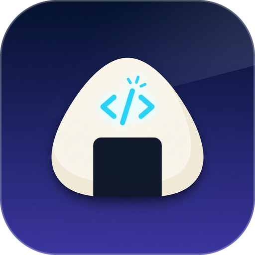

<div align="center">
  
  <h1>Onigiri Editor User Manual 🍙</h1>
  <p><strong>AI-era cross-platform Markdown, code &amp; dev-preview desktop editor (v1.0.5)</strong></p>
  <p>
    <strong>English</strong> | <a href="README.ja.md">日本語</a> ・
    <a href="../README.md">Repository Home (README)</a>
  </p>
</div>

---

## Table of Contents

1. [Getting Started & Language Settings](#1-getting-started--language-settings)
2. [Three UI Modes & Layout Controls](#2-three-ui-modes--layout-controls)
3. [Markdown & Bidirectional Visual Editing](#3-markdown--bidirectional-visual-editing)
4. [Advanced Editing & Right-Click Context Menu](#4-advanced-editing--right-click-context-menu)
5. [Character Encodings & Line Endings (EOL)](#5-character-encodings--line-endings-eol)
6. [Multi-Language Syntax Highlighting & Previews](#6-multi-language-syntax-highlighting--previews)
7. [Workspace, Session Restore & File Watching](#7-workspace-session-restore--file-watching)
8. [Dev Server Integration & Dual Browser Preview](#8-dev-server-integration--dual-browser-preview)
9. [AI Chat, Connection Assistant & Formatting Tools](#9-ai-chat-connection-assistant--formatting-tools)
10. [Export, Themes & Settings Reference](#10-export-themes--settings-reference)
11. [Keyboard Shortcuts & Menu Bar Reference](#11-keyboard-shortcuts--menu-bar-reference)

---

## 1. Getting Started & Language Settings

**Onigiri Editor** is a lightweight, high-speed desktop editor built for **macOS (Apple Silicon & Intel)**, **Windows (x64)**, and **Linux (x64)**.

### First-Launch Language Detection

- On first launch, Onigiri Editor detects your OS language automatically: Japanese OS environments start with the **Japanese UI and native menu bar**, while all other OS languages start in **English**.
- You can switch languages anytime from the top-right **Language button** (`EN` / `日本語`), **Settings (`⌘,` / `Ctrl+,`) → General & View**, or the **Command Palette (`⌘K` / `Ctrl+K`)**.
- Selecting **Help → Online Manual** (or **Online Manual** in the Command Palette) opens the manual matching your current UI language: **this English manual (`doc/README.md`) in English UI, or the Japanese manual (`doc/README.ja.md`) in Japanese UI**.

---

## 2. Three UI Modes & Layout Controls

Switch anytime via the top header bar, **View** menu, or **`⌘\` / `Ctrl+\`**:

| Mode | Best For | Layout & Capabilities |
| :--- | :--- | :--- |
| **Simple** | Quick notes & fast code edits | Ultra-minimal single-pane editor with tabs and sidebar hidden |
| **Basic** | Daily writing, visual editing & AI | Editor + bidirectional live preview + format toolbar + AI Chat |
| **Advanced** | Dev workflows & multi-file projects | Multi-tab bar, left sidebar (Files / Outline / Snippets), dev server launcher, snapshots, writing goal & token counter |

### Layout & Bar Visibility

- **View Layout**: Switch between **Editor**, **Split**, and **Preview** in the top header bar.
- **Zen Mode**: Press `⌘⇧F` / `Ctrl+Shift+F` to hide surrounding chrome for distraction-free writing (`Esc` to exit).
- **Header Bar, Format Toolbar & Status Bar Toggles**:
  - Toggle **View → Show Header Bar** and **View → Show Format Toolbar** from the native menu bar, Settings, or Command Palette.
  - **Settings → General & View** also provides **Hide top header bar in Simple mode** and **Show format toolbar in Simple mode**.
  - Even while the top header bar is hidden, you can restore modes or open Settings via the bottom-right **Status Bar quick buttons** (`Simple → Basic`, `Settings`), the **View** menu, `⌘,` / `Ctrl+,`, or `⌘\` / `Ctrl+\`.

---

## 3. Markdown & Bidirectional Visual Editing

### Bidirectional Sync (CodeMirror 6 ↔ TipTap)

- In **Split** or **Preview** layout, edits in the left Markdown source editor (CodeMirror 6) and the right rich visual editor (TipTap) stay synchronized in real time.
- **Active Line / Block Sync Highlight**: When enabled in Settings, editing in one pane highlights the corresponding block or line in the opposite pane.
- **Sync Scroll & Typewriter Scroll**: Toggle synchronized scrolling between editor and preview, or keep the active line centered vertically in **Typewriter Scroll** mode.

### Format Toolbar, Edit/Zoom Controls & Rich Content

- **Edit & Display Zoom**: **Select All**, **Copy**, **Paste**, **Zoom Out**, and **Zoom In** buttons directly on the Format Toolbar (also works in Visual Preview), plus a clickable **`100%`** zoom readout in the Status Bar (`25%`–`400%` numeric input, `−`/`+` steppers, presets, or `⌘+` / `⌘-` / `⌘0`).
- **Headings & Text Styling**: `H1` / `H2` / `H3`, Bold (`⌘B` / `Ctrl+B`), Italic (`⌘I` / `Ctrl+I`), Strikethrough, Inline Code, and Code Block.
- **Lists & Structure**: Bullet List, Numbered List, Task List (`- [ ]`), Blockquote (`>`), GFM Table, and Divider (`---`).
- **Links & Images**:
  - Use the Image toolbar button to insert from a **Local File** or **Image URL** with optional Alt text.
  - You can also **drag & drop image files** onto the editor or preview pane, or **paste images directly from the clipboard**.
- **Extended Blocks**:
  - **Math (KaTeX)**: Inline (`$ ... $`) and block (`$$ ... $$`) LaTeX math rendering.
  - **Mermaid Diagrams**: Live rendering for `` ```mermaid `` code blocks (flowcharts, sequence diagrams, state diagrams, etc.) with one-click SVG copy.
  - **GitHub Callouts**: Styled rendering for `> [!NOTE]`, `> [!TIP]`, `> [!IMPORTANT]`, `> [!WARNING]`, and `> [!CAUTION]`.
- **YAML Frontmatter (Metadata)**: Open the **Metadata** tab in the right Options drawer to add frontmatter, edit key/value pairs, or toggle the metadata card at the top of the preview.

---

## 4. Advanced Editing & Right-Click Context Menu

### Smart Line Copy

- Press **`⌘C` / `Ctrl+C` with no text selected** to copy the entire current line automatically.
- Configure behavior under **Settings → Editor & Line Copy**:
  - **Line Copy Trigger**: **End of line only** or **Anywhere on line (when no selection)**
  - **Trailing Newline**: Toggle **Include trailing newline (`\n`) when copying line**

### Column Ruler, Wrap Modes, Visible Symbols & Bracket Matching

- **Column Ruler**: Displays a column scale (`0`, `10`, `20`, ...) along the top of the editor.
- **Word Wrap Modes**: Choose **Wrap at Window Edge**, **Wrap at Specified Column** (customizable column width), or **No Wrap**.
- **Visible Symbols**: Independently toggle **Line Ending Symbols (`↓`)** and **Whitespace & Tab Symbols (`·` / `□` / `→`)**.
- **Matching Bracket Highlighting**: Placing the cursor on `()`, `[]`, `{}`, etc. highlights the matching bracket pair (toggleable in Settings).
- All of these options are also searchable in the **Command Palette (`⌘K` / `Ctrl+K`)**.

### Find & Replace (`⌘F` / `Ctrl+F`)

- On Windows/Linux, `Ctrl+H` jumps directly to the Replace input. Navigate matches with `F3` / `⌘G` and `Shift+F3` / `⌘⇧G`.
- **Search Options**:
  - **Match Case**
  - **Distinguish Full/Half-Width Alphanumerics**
  - **Whole Word**
  - **Regular Expression** (when OFF, `$1` etc. in replacements are kept literal)
  - **In Selection**: Restrict find/replace to the selected range (click **Re-capture current editor selection** to refresh the range)

### Go to Line (`⌘L` / `Ctrl+L`)

- Open from **Edit → Go to Line...**, shortcut **`⌘L` / `Ctrl+L`**, Command Palette, or by **clicking the `Ln X, Col Y` readout in the Status Bar**.
- Enter `120` (line number) or `120:15` (`line:col`); full-width digits and colons are also accepted.

### Editor Right-Click Context Menu

Right-click inside the editor to access:

- **Standard Actions**: Undo, Redo, Cut, Copy, Paste, Delete, Select All
- **Rectangular Selection**: Toggle box-selection mode (drag to select rectangular columns, `Esc` to exit), or hold `Alt` (`Option` on macOS) while dragging anytime.
- **Advanced**:
  - **Indent / Unindent (Tab & Space)**
  - **Insert / Remove Comment** (uses syntax appropriate for the active language)
  - **Convert Spaces to Tabs / Tabs to Spaces**
  - **Convert to Lowercase / Uppercase**
  - **Reverse Lines / Sort Lines (Ascending / Descending) / Remove Duplicate Lines**
  - **Trim Leading / Trailing Whitespace**
  - **Insert / Remove `>` Quote**
  - **Insert Line Breaks at Wrap / Remove Line Breaks**
- **Half / Full-Width**: `To Full-width`, `To Full-width (Katakana)`, `To Full-width (Alphanumeric)`, `To Half-width`, `To Half-width (Katakana)`, `To Half-width (Alphanumeric)`
- **Bookmarks**:
  - **Toggle Bookmark** (shows markers in the line-number gutter)
  - **Next Bookmark / Previous Bookmark / Clear All Bookmarks**

---

## 5. Character Encodings & Line Endings (EOL)

### Supported Formats

- **Encodings**: `UTF-8`, `UTF-8 (BOM)`, `Shift_JIS (CP932)`, `EUC-JP`, `ISO-2022-JP (JIS)`, `UTF-16 LE`, `UTF-16 BE`
- **Line Endings**: `LF (\n)`, `CRLF (\r\n)`

### How to Use

- **New File with Encoding**: Open via **File → New File with Encoding...**, Command Palette, or the Status Bar encoding popover (**New File with Encoding...**) to choose both encoding and EOL for a new tab.
- **Reopen from Disk**: Use **File → Reopen with Encoding...** or click the **Encoding pill (e.g. `UTF-8`) in the Status Bar → Reopen tab** to reload a saved file from disk using a specific encoding (prompts if you have unsaved edits).
- **Change Save Encoding / EOL**: Click the **Encoding pill (`Save As` tab)** or **`LF` / `CRLF` pill** in the Status Bar, or run the command from the Command Palette. Saving warns you if characters cannot be represented in the target encoding (such as Shift_JIS).
- **Defaults**: Configure **Default Encoding for New Files** and **Default Line Ending for New Files** under **Settings → Editor & Line Copy**.

---

## 6. Multi-Language Syntax Highlighting & Previews

- **100+ Languages**: Automatic syntax highlighting by file extension for Markdown, PHP, TypeScript/JavaScript, Python, Rust, Go, SQL, HTML, CSS, YAML, JSON, TOML, XML, Shell scripts, and more.
- **Presets & Per-Token Colors**:
  - Under **Settings → Syntax Colors**, pick from 7 presets (`Auto`, `GitHub`, `One Dark`, `Dracula`, `Nord`, `Monokai`, `Solarized`).
  - Customize 10 individual token categories (keywords, strings, numbers/booleans, comments, functions, types, variables, operators, tags, properties).
- **Specialized Live Previews**:
  - **HTML (`.html` / `.htm`)**: **HTML Live Page Preview** in the right pane with **Full Width** and **Mobile (390px)** viewport toggles (plus dev-server prompts if an app entry HTML is detected).
  - **SVG (`.svg`)**: Real-time **SVG Live Preview**.
  - **Source Code**: Right-pane **Code Preview (Synced Line)** synchronized with the cursor line.

---

## 7. Workspace, Session Restore & File Watching

### Folder Explorer & Sidebar (Advanced Mode)

- **Files Tab**: Open a workspace folder (`⌘⇧O` / `Ctrl+Shift+O`) to browse a **collapsible hierarchical folder tree** (with **Collapse All** and auto-refresh), preview workspace images in the **Image Gallery Modal** (with Next/Prev and Markdown insertion), filter by filename, run **Full-Text Search** across the folder, or create a **New Note in Folder**. Switching folders while a dev server is running prompts with **Stop & Switch** / **Disconnect & Switch**.
- **Outline Tab**: Lists Markdown headings (`#` to `######`); click any heading to jump to it.
- **Snippets Tab**: Click to insert Markdown templates, tables, Mermaid diagrams, KaTeX blocks, or callouts at the cursor.

### Session Restore, Window Geometry, Draft Recovery & Auto-Save

- Automatically saves and restores open tabs, unsaved drafts, cursor positions, window position/size, and the open workspace folder across restarts (configurable in Settings).
- **Auto-Save**: Enable **Auto-save modified files to disk** under **Settings → General & View** to save file-backed tabs automatically after 1.5 seconds of inactivity (pauses safely on external file conflicts).

### External File Change Detection

- Watches open files on disk for modifications from external editors or AI CLIs.
- Clean tabs reload automatically; if you have unsaved edits or the file was deleted/moved, a banner lets you **Reload from Disk**, **Compare Diff**, **Keep Mine**, **Save to File Again**, or **Keep as Unsaved Draft**.

### Snapshots & History Diff

- Use the **History** tab in the right Options drawer to save labeled checkpoints and inspect line-by-line diffs against snapshots or the saved version on disk, or restore an earlier snapshot.

---

## 8. Dev Server Integration & Dual Browser Preview

When you open a project folder (`⌘⇧O` / `Ctrl+Shift+O`) or project file, Onigiri Editor automatically detects the stack and provides dev server controls in the sidebar and right pane.

### Auto-Detected Stacks

- **JavaScript / Frontend**: Vite, Next.js, Astro, Nuxt (including serving built `dist/` folders over local HTTP)
- **PHP**: Laravel, WordPress, generic PHP projects
- **Python**: Django, FastAPI, Flask, Streamlit
- **Static / Docs / Containers**: MkDocs, Hugo, Docker Compose, Static HTML

### Pre-Flight Environment Check & Guided Setup

- Diagnoses required runtimes (Node.js, PHP, Composer, Python, Docker, etc.) and configuration files (`.env`, `wp-config-sample.php`, etc.) before launching.
- When prerequisites are missing, guided setup cards provide:
  - **Blue action button**: Runs setup automatically inside Onigiri Editor
  - **Run in Terminal**: Opens your OS Terminal / Command Prompt for interactive installation
  - **Download Page**: Opens the official download page
- Click **Re-check Environment** once installation finishes (from `v1.0.4` onward, Windows reads Registry `PATH` live so newly installed tools are typically detected without restarting the app).

### Pattern 1: Built-in Web Browser

1. Enable **Enable built-in Web Browser switcher in right pane** under **Settings → AI & Browser**.
2. Switch the right pane to **Web Browser** or click **Open Built-in Browser** on the project card.
3. Includes Back, Forward, Reload, URL bar, and **Open in External Browser** (powered by WKWebView on macOS, Edge WebView2 on Windows, and WebKitGTK on Linux).

### Pattern 2: External Browser Live Preview (with LAN Sharing)

1. Click **External Browser** in the preview header, choose **View → Live Preview in External Browser**, or run it from the Command Palette.
2. Starts a local HTTP server (`127.0.0.1`, configurable port) serving an auto-reloading live preview in Chrome, Safari, Edge, or Firefox.
3. Enable **Allow access from other devices on the local network (LAN)** in Settings to bind to `0.0.0.0` and copy the **LAN URL** to preview on phones or other PCs on the same Wi-Fi/LAN.

---

## 9. AI Chat, Connection Assistant & Formatting Tools

Click the top-right **Options / AI Chat** icon (robot icon) to open the right drawer.

### Supported AI Providers

| Category | Providers | Highlights |
| :--- | :--- | :--- |
| **Subscription CLIs** | **Codex CLI**, **Claude Code CLI**, **Gemini CLI**, **Antigravity CLI** (`agy`) | Local CLI execution, model selector, plus **Setup in Terminal** & **Sign in via Terminal** assistance |
| **Cloud APIs** | **OpenAI API**, **Anthropic API**, **Gemini API** | Direct connection with your API key, model name, and custom Base URL |
| **Local AI** | **Ollama**, **LM Studio** | Offline private models with Ollama launcher/model-pull helpers and LM Studio server instructions |
| **Custom CLI** | Any custom command | Integrate custom CLI tools via `{prompt}` placeholder or stdin |

### Document & Folder Context with Diff Preview

- **Include current document context**: Share the active file with AI for Q&A, proofreading, summarizing, polishing, or translating (with one-click quick prompts). CLI runs stream live progress updates and provide a **Stop** button to cancel long tasks cleanly.
- **AI Folder Access (Advanced Mode)** (switchable directly from the AI Chat **Folder Access** pill or **Settings → AI & Browser**):
  - **Disabled**: Active document only
  - **Read-Only**: Reference files inside the open folder
  - **Read + Write (Apply after approval)**: Inspect AI file proposals in a **line-by-line Diff Preview Modal** before writing to the folder
  - **CLI Direct Workspace Write**: Allow Codex / Claude / Gemini CLI to modify workspace files directly
- AI replies can be inserted at the cursor (**Insert**), previewed and applied via **Replace Doc** (with optional pre-apply snapshot), or copied.

### Formatter & Stats (Token Estimates)

- **Formatter Tab**:
  - **AI Output Cleanup & Formatter**: Removes zero-width characters, trims trailing spaces, collapses excessive blank lines, aligns GFM table columns, normalizes bullets (`*`/`+` → `-`), fixes heading spacing, and optionally normalizes smart quotes.
  - **Paste Clipboard HTML as Markdown** (auto-conversion on paste can be toggled in Settings).
  - **Copy as Rich Text**: Paste cleanly into Notion, Google Docs, or Slack.
- **Stats Tab**: Shows characters (with/without spaces), words, lines, paragraphs, reading time, **Estimated AI Tokens**, heading/code/table/link counts, and writing goal progress.

---

## 10. Export, Themes & Settings Reference

### Export & Copy Actions

- **Export HTML** (standalone styled HTML document)
- **Print / Export PDF**
- **Export Plain Text**
- **Copy Markdown / Copy HTML / Copy Rich Text**

### Themes & Preview Styling

- **Color Themes**: `Light`, `Dark`, `Sepia`, `Midnight`
- **Preview Styles**: `Editorial`, `GitHub`, `Notion`, `Academic` + **Custom Preview CSS** targeting `.markdown-body`

### Settings Tabs (`⌘,` / `Ctrl+,`)

- **General & View**: UI Language, Color Theme, Preview Style, Font Size, Line Height, Preview Max Width, Editor Font (`Monospace` / `Sans-serif`), Header Bar / Format Toolbar / Status Bar visibility toggles, Session Restore, Auto-Save, Writing Goal, Custom Preview CSS
- **Editor & Line Copy**: Line Numbers, Word Wrap Mode & Column Width, Column Ruler, Line Ending & Whitespace Symbols, Matching Brackets, Default New File Encoding & EOL, Active Line/Block Sync Highlight, Sync Scroll, Typewriter Scroll, Smart HTML Paste, Smart Line Copy options
- **Syntax Colors**: 7 syntax presets + 10 per-token color pickers
- **AI & Browser**: AI Folder Access mode, Built-in Web Browser toggle & default URL, External Browser Live Preview toggle, local port, and LAN sharing

---

## 11. Keyboard Shortcuts & Menu Bar Reference

### Key Shortcuts

| Action | macOS | Windows / Linux |
| :--- | :--- | :--- |
| New File | `⌘ + N` | `Ctrl + N` |
| Open File | `⌘ + O` | `Ctrl + O` |
| Open Folder | `⌘ + ⇧ + O` | `Ctrl + Shift + O` |
| Save / Save As | `⌘ + S` / `⌘ + ⇧ + S` | `Ctrl + S` / `Ctrl + Shift + S` |
| Close Tab | `⌘ + W` | `Ctrl + W` |
| Open Settings | `⌘ + ,` | `Ctrl + ,` |
| Command Palette | `⌘ + K` / `⌘ + P` | `Ctrl + K` / `Ctrl + P` |
| Find & Replace | `⌘ + F` | `Ctrl + F` (Replace focus: `Ctrl + H`) |
| Find Next / Previous | `⌘ + G` / `⌘ + ⇧ + G` / `F3` | `Ctrl + G` / `Ctrl + Shift + G` / `F3` |
| Go to Line | `⌘ + L` | `Ctrl + L` |
| Smart Line Copy (no selection) | `⌘ + C` | `Ctrl + C` |
| Bold / Italic | `⌘ + B` / `⌘ + I` | `Ctrl + B` / `Ctrl + I` |
| Zoom In / Zoom Out / Reset (`25%`–`400%`) | `⌘ + +` / `⌘ + -` / `⌘ + 0` | `Ctrl + +` / `Ctrl + -` / `Ctrl + 0` |
| Switch Mode (Simple/Basic/Advanced) | `⌘ + \` | `Ctrl + \` |
| Toggle Zen Mode | `⌘ + ⇧ + F` | `Ctrl + Shift + F` |
| Send AI Chat Message | `⌘ + Enter` | `Ctrl + Enter` |
| Dismiss Modal / Find / Zen / Box Select | `Esc` | `Esc` |

### Native Menu Bar Structure

- **File**: New File, New File with Encoding..., Open File..., Reopen with Encoding..., Open Folder..., Save, Save As..., Export HTML..., Print / Export PDF..., Close Tab *(on Windows/Linux, Settings and Quit also appear in File)*
- **Edit**: Undo, Redo, Cut, Copy, Paste, Select All, Find & Replace, Go to Line...
- **View**: Simple Mode, Basic Mode, Advanced Mode, Show Header Bar, Show Format Toolbar, Command Palette, Options / AI Chat, Live Preview in External Browser, Zen Mode
- **Window**: Minimize, Close Window
- **Help**: **Online Manual**, About Onigiri Editor *(on macOS, Settings is in the **Onigiri Editor** app menu)*
